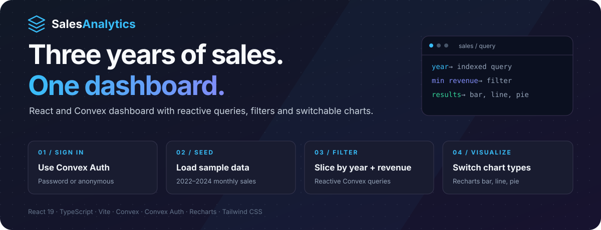
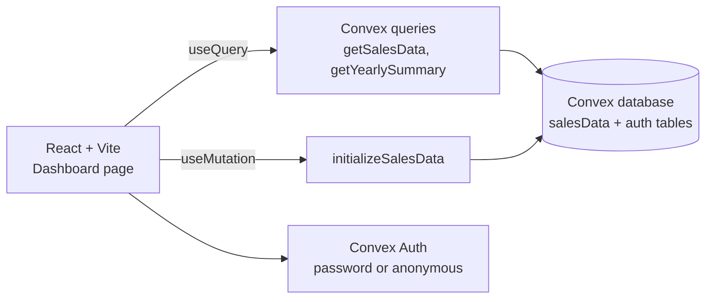

<p align="center">
  
</p>

<p align="center">
  <strong>An interactive sales dashboard on a reactive backend.</strong><br />
  Filter three years of monthly sales by year and revenue, and switch between bar, line and pie charts instantly.
</p>

<p align="center">
  <a href="https://admired-meadowlark-784.convex.app"></a>
</p>

<p align="center">
  
  
  
  
  
</p>

<p align="center">
  <a href="#the-product">Product</a> ·
  <a href="#engineering-decisions">Engineering</a> ·
  <a href="#architecture">Architecture</a> ·
  <a href="#run-locally">Run locally</a> ·
  <a href="#creator">Creator</a>
</p>

> On the live demo, choose **Sign in anonymously** to look around without creating an account.

---

## The product

Sales numbers usually arrive as a spreadsheet: hard to compare across years and slow to slice.

**Sales Analytics turns monthly sales into an interactive dashboard.** KPIs sit at the top, filters narrow the data by year and minimum revenue, and the same data can be read as monthly bars, a trend line or a share-by-year pie. Queries are reactive, so the view updates as soon as the data changes.

| Capability | What you can do |
| :--- | :--- |
| **KPIs** | See total revenue, total units and average monthly revenue for the current filter. |
| **Year filter** | Show 2022, 2023, 2024 or all years, backed by an indexed Convex query. |
| **Revenue threshold** | Hide months below a minimum revenue. |
| **Chart switching** | Toggle bar (monthly comparison), line (trend) and pie (share by year) charts. |
| **Yearly summary** | Revenue and units totalled per year. |
| **Authentication** | Password sign-up/sign-in or anonymous access through Convex Auth. |
| **Responsive layout** | Works on desktop, tablet and mobile. |

### A workflow you can follow

**Sign in → sample data is seeded once → pick a year → set a revenue floor → switch chart type**

## Engineering decisions

| Engineering problem | Implementation | Inspect the code |
| :--- | :--- | :--- |
| Filtering by year should not scan the whole table | The schema defines `by_year` and `by_year_month` indexes; the query uses `withIndex` when a year is selected. | [`convex/schema.ts`](convex/schema.ts), [`convex/salesData.ts`](convex/salesData.ts) |
| Seeding must not duplicate data on every visit | The seed mutation checks for existing rows and inserts only into an empty table. | [`initializeSalesData`](convex/salesData.ts) |
| Dashboards drift out of date | Convex `useQuery` subscriptions re-render automatically when data changes. | [`Dashboard.tsx`](src/components/pages/Dashboard.tsx) |
| UI code grows messy as charts are added | Components follow atomic design: atoms, molecules, organisms and pages. | [`src/components`](src/components) |

## Architecture



```text
src/components/
├── atoms/          Button, Card, Input
├── molecules/      FilterControls, ChartTypeSelector
├── organisms/      SalesChart, SalesMetrics
└── pages/          Dashboard
```

| Layer | Technology |
| :--- | :--- |
| Frontend | React 19, TypeScript, Vite, Tailwind CSS, Sonner toasts |
| Charts | Recharts |
| Backend & database | Convex queries, mutations and schema |
| Auth | Convex Auth (Password and Anonymous providers) |

The data is **demonstration data**: 36 months (2022–2024) of electronics sales for North America, from $85,000 to $210,000 revenue and 620 to 1,580 units per month, with growth and seasonal patterns.

<details>
<summary><strong>Scope and known limitations</strong></summary>

- The dataset is sample data seeded by the app, not real business figures.
- There is a single product and region, so product and region breakdowns are not shown yet.
- The project was scaffolded with [Convex Chef](https://chef.convex.dev); the original Chef notes are in [`CHEF_README.md`](CHEF_README.md).

</details>

## Run locally

Requirements: **Node.js 18+** and a free [Convex](https://convex.dev) account.

```bash
git clone https://github.com/Lingu17/Sales-Analytics.git
cd Sales-Analytics
npm install
npm run dev
```

`npm run dev` starts the Vite frontend and `convex dev` together. On first run, Convex asks you to log in and create or select a deployment, then writes `.env.local` with its URL. Sign in (or use **Sign in anonymously**) and the dashboard seeds its sample data.

| Script | Purpose |
| :--- | :--- |
| `npm run dev` | Frontend and Convex backend in parallel |
| `npm run build` | Production build |
| `npm run lint` | Type-check Convex and app code, push functions once, then build |

## Project map

```text
Sales-Analytics/
├── convex/
│   ├── schema.ts        salesData table with year indexes, auth tables
│   ├── salesData.ts     Seed mutation, filtered query, yearly summary
│   └── auth.ts          Convex Auth with Password and Anonymous providers
├── src/
│   ├── App.tsx          Auth gate and layout
│   ├── components/      Atomic design components
│   └── SignInForm.tsx   Sign-in / sign-up form
└── vite.config.ts       Vite configuration
```

## Creator

**Lingraj Malipatil** · [GitHub @Lingu17](https://github.com/Lingu17) · [LinkedIn](https://www.linkedin.com/in/lingraj-malipatil-a2735a241/)

---

<p align="center"><strong>Sales Analytics</strong><br />Three years of sales. One dashboard.</p>
